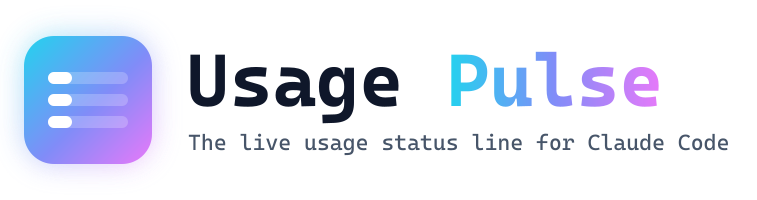

<p align="center">
  <picture>
    <source media="(prefers-color-scheme: dark)" srcset="assets/logo.svg">
    
  </picture>
</p>

<p align="center">
  <strong>Every limit, cost and agent, live under your prompt. Plus every other AI subscription you pay for.</strong>
</p>

<p align="center">
  <a href="https://github.com/NoobyGains/usage-pulse/stargazers"></a>
  <a href="https://github.com/NoobyGains/usage-pulse/tags"></a>
  
  
  
  
  <a href="LICENSE"></a>
</p>

<p align="center">
  <a href="#install">Install</a> •
  <a href="#see-it-in-action">Demos</a> •
  <a href="#every-subscription-one-screen">Providers</a> •
  <a href="#themes-animation-and-layout">Themes</a> •
  <a href="#widgets">Widgets</a> •
  <a href="#agents-and-teams">Agents</a> •
  <a href="#full-flag-list">Flags</a> •
  <a href="CHANGELOG.md">Changelog</a>
</p>

<p align="center">
  
</p>

> [!TIP]
> One minute from zero to a live bar: `/plugin install usage-pulse --marketplace NoobyGains/usage-pulse`, then `/usage-pulse:setup`, then restart Claude Code.

## Why Usage Pulse

<table>
  <tr>
    <td width="33%" valign="top">
      <h3>⚡ Zero API calls</h3>
      The 5-hour and weekly bars, the countdowns, context and cost all come from what Claude Code already pipes to the status line. No key, no polling, nothing to rate limit.
    </td>
    <td width="33%" valign="top">
      <h3>🧭 Every subscription on one screen</h3>
      A second Claude account, Codex, Gemini / Antigravity, MiniMax or any JSON file gets its own row, found for you and drawn in the same theme.
    </td>
    <td width="33%" valign="top">
      <h3>💸 Costs you can compare</h3>
      API-equivalent spend per session in your currency, priced per model for Fable 5.1, Opus 5.5, Sonnet 5.5 and Haiku 5.5, with budget, 7-day and all-time views.
    </td>
  </tr>
  <tr>
    <td width="33%" valign="top">
      <h3>🤖 Agents, live</h3>
      How many subagents are running and spawned against the cap, agent-team task progress, and a row per subagent in the agent panel with model, effort, context and time.
    </td>
    <td width="33%" valign="top">
      <h3>🎨 Made to look good</h3>
      10 themes, 5 animations, 8 bar styles, 5 sizes, 4 layouts and 48 widgets, all chosen in a full-screen wizard with live previews. You never edit JSON.
    </td>
    <td width="33%" valign="top">
      <h3>🪶 One file</h3>
      A single Python script, zero dependencies, Python 3.8+, Windows, macOS and Linux. Installs in a minute, updates itself with <code>--update</code>.
    </td>
  </tr>
</table>

## Install

**As a Claude Code plugin**

```
/plugin install usage-pulse --marketplace NoobyGains/usage-pulse
/usage-pulse:setup
```

A plugin cannot register a status line by itself, so `/usage-pulse:setup` writes it into `settings.json` with safe defaults. Afterwards `/usage-pulse:pulse setup` chooses hooks, providers, theme and widgets. On Claude Code older than 2.1.275, add the marketplace first with `/plugin marketplace add NoobyGains/usage-pulse`, then `/plugin install usage-pulse`.

**One line**

```bash
# macOS, Linux, Git Bash
curl -fsSL https://raw.githubusercontent.com/NoobyGains/usage-pulse/main/install.sh | bash
```

```powershell
# Windows PowerShell
irm https://raw.githubusercontent.com/NoobyGains/usage-pulse/main/install.ps1 | iex
```

Both clone the repo to `~/.usage-pulse` and open the setup wizard. Then restart Claude Code.

<details>
<summary><b>By hand, installer variables, and what the plugin's hook does</b></summary>

```bash
git clone https://github.com/NoobyGains/usage-pulse.git ~/.usage-pulse
python3 ~/.usage-pulse/claude_status.py --setup
```

- `USAGE_PULSE_DIR` picks another install folder, `USAGE_PULSE_REPO_URL` another source, and `USAGE_PULSE_NONINTERACTIVE=1` (dotfiles, CI) takes the defaults without a terminal. The older `CLAUDE_PULSE_*` names still work.
- An install from before the rename stays in `~/.claude-pulse`; the installers update it in place.
- The plugin ships exactly one hook, on `SessionStart`: plugin updates land in a new version folder and Claude Code deletes the old one two weeks later, so the hook re-points `settings.json` at the current folder when it is stale. It never touches a git or manual install and prints nothing otherwise.
- `python3 ~/.usage-pulse/claude_status.py --update` brings the next release to a git install; plugin installs update with `/plugin update usage-pulse`.

</details>

## See it in action

### Two minutes of setup, nothing to edit

<p align="center">
  
</p>

`--setup` is a full-screen wizard with 14 screens. It reports what it found (Python, Claude Code, your config folder, a status line it can replace), then walks through hooks, the providers on this machine, per-model caps, theme, bar size, bar style, layout, currency, clock, effort format and widgets. Every choice that changes the look has a live preview, nothing is written until you confirm the summary, Esc anywhere changes nothing, and `settings.json` is backed up before the first write. Inside Claude Code, `/pulse` offers the same choices as a menu, and `/pulse setup`, `/pulse providers`, `/pulse hooks`, `/pulse show` and `/pulse ocean` jump straight to a part.

### Ten themes, five animations

<p align="center">
  
</p>

<p align="center">
  
</p>

Bars shift from each theme's low colour through mid to high as a window fills. The rainbow, pulse, glow and shift animations advance on every repaint, so the bar keeps moving while you think.

### Four layouts, forty-eight widgets

<p align="center">
  
</p>

<p align="center">
  
</p>

Switch any widget on or off, reorder by priority, split the bar over two rows, and it still fits a narrow terminal by dropping the least important widgets first.

### Agents and teams, as they happen

<p align="center">
  
</p>

The counter and the team segment come from two optional hook groups. The agent panel rows need no hook at all: Claude Code asks Usage Pulse to draw each subagent's row.

### It tells you when there is something new

<p align="center">
  
</p>

Once an hour the bar checks for a new Usage Pulse release and a new Claude Code release. `--update` pulls the new version, verifies the commit against GitHub, rolls back if they differ and prints what changed.

## What's on the bar

```
Session ━━━───────── 27% 2h 53m | Weekly ━━━━━━━━━─── 73% R:Fri 3pm | Context ━━━━──────── 35% | $38.75 | +142 -37 | Opus 5.5 | Effort: XHigh | ⚡fast | main
```

1. **Session**: the 5-hour window, with the time until it resets.
2. **Weekly**: the 7-day window, with the day and time it resets.
3. **Context**: how full the context window is. A `⚠ Context` label appears above 90%, or above 70% while it fills quickly.
4. **Cost**: what this session would cost at API prices, in your currency.
5. **Lines changed**, **Model**, **Effort**, **Fast mode** and **Branch**.

That is the default. Everything on it can be hidden, reordered or swapped for one of the widgets below.

## Every subscription, one screen

Providers add one row per *other* subscription under the main line. `--detect-providers` lists what this machine has, and the wizard or `/pulse providers` switches rows on.

| What | Id | Where it is read from |
|---|---|---|
| Other Claude Code accounts | `claude:default`, `claude:<suffix>` (for example `claude:b` for `~/.claude-b`) | Every `~/.claude*` folder that holds a `.credentials.json` |
| Codex CLI | `codex` | Session files under `~/.codex` |
| Google Antigravity (Gemini) | `gemini`, `gemini:<suffix>` | `statusline_last_live.json` under `~/.gemini/antigravity-cli*` |
| MiniMax | `minimax` | The `mmx` CLI on your PATH. Never switched on automatically |
| Anything else | `file:<name>` | A JSON file that any tool can write |

```bash
python3 ~/.usage-pulse/claude_status.py --detect-providers          # what is here
python3 ~/.usage-pulse/claude_status.py --providers enable claude:b,codex
python3 ~/.usage-pulse/claude_status.py --providers label claude:b Work
python3 ~/.usage-pulse/claude_status.py --providers list
```

The sub-commands are `list`, `detect`, `enable`, `disable`, `label`, `remove` and `add-file`. `--detect-providers --json` gives machine-readable output. Labels are 24 characters at most, up to 8 providers can be configured and at most 6 rows are shown.

- Rows use the main line's theme, bar style and size. With `providers_label_main` on (the default) the main line's `Session` label becomes `Claude (<label>) 5h` so everything lines up.
- **Another Claude account** uses that account's own token, read from its `.credentials.json`. It is never refreshed, stored or logged. At most one usage-API call per account every `providers_refresh_seconds` (300 by default, 60 at the lowest), never more than one a minute, with back-off on 429 and a 15-minute pause on 401 or 403. Each window also saves its own account's numbers from stdin, so with both windows open no API call is made at all.
- **Codex and Gemini** rows are read from local files only: the last values seen, never a network call.
- **MiniMax** runs `mmx` to read its quota, which is why it is never on by default, and it is hidden while the window itself runs on MiniMax.
- A row whose data is more than 30 minutes old is drawn dim with a `~` in front of the number, such as `~29%`.

<details>
<summary><b>Your own provider from a JSON file</b></summary>

`--providers add-file <id> <path> [label]` adds a row read from a file. A ten-line script that polls any other service can feed it. The id is stored as `file:<id>`.

```json
{"label": "Kimi",
 "five_hour": {"used_percentage": 42, "resets_at": 1792386351},
 "seven_day": {"used_percentage": 7,  "resets_at": "2026-10-26T10:00:00Z"}}
```

The two windows may sit at the top level or inside a `rate_limits` object (Claude Code's own shape), `utilization` is accepted for `used_percentage`, `resets_at` may be epoch seconds, epoch milliseconds or ISO 8601, either window may be missing, and the file may be 1 MB at most.

</details>

<details>
<summary><b>Two or more Claude accounts on one machine</b></summary>

Claude Code's pattern is one config folder per account, `CLAUDE_CONFIG_DIR=~/.claude-work claude`. Run `--setup` once per account with that variable set:

```bash
CLAUDE_CONFIG_DIR=~/.claude-work python3 ~/.usage-pulse/claude_status.py --setup
```

State that belongs to one account (usage cache, stdin context, history, sessions, heatmap, cost caches) lives in `<state folder>/accounts/<name>-<hash>/`, so two windows on two accounts never overwrite each other. `config.json` stays shared.

</details>

## Themes, animation and layout

**10 themes**: default, ocean, sunset, mono, neon, pride, frost, ember, candy and rainbow. `--theme ocean`, `/pulse ocean`, or `--pick-theme` for an arrow-key picker with a live preview.

**5 animation modes** with `--animate <mode>`:

| Mode | Effect |
|---|---|
| `off` | Static, no animation |
| `rainbow` | A flowing rainbow gradient across the whole bar |
| `pulse` | Bars cycle through vivid colours (cyan, blue, purple, pink, gold, green) |
| `glow` | A per-character gradient that shifts across the bar each frame |
| `shift` | A bright highlight that slides across the bar |

`--animation-speed` takes `slow`, `normal` or `fast`. Animation needs repaints, so setup writes a 2-second `refreshInterval` while animation is on.

**8 bar styles** with `--bar-style <name>`: classic, block, shade, pipe, dot, square, star, braille. If Unicode looks wrong in your terminal, `block` is the safe one. **Bar sizes**: small, small-medium, medium, medium-large, large (`--bar-size`). A named size is exactly that wide whatever the window does; `--bar-size auto` shrinks the bars to fit a narrow window instead, and `--wrap auto` moves what does not fit onto a second row.

**Layouts** (`--layout`): `standard` has full labels, `compact` one-letter labels, `minimal` no labels, and `percent-first` puts the number before the bar. `--max-width` sets the share of the terminal the bar may use and `--wrap auto` wraps onto a second row instead of cutting the line. For a deliberate two-row split, set `line2_widgets` (these go to row 2) or `line1_widgets` (an allowlist for row 1, the rest flows to row 2) in `config.json`.

## Widgets

Switch any of them with `--show` and `--hide`, or tick them in the wizard. Most read fields Claude Code already pipes in, so they cost nothing.

<details>
<summary><b>All 48 widgets and their defaults</b></summary>

| Id | Default | What it shows |
|---|---|---|
| `session` | on | The 5-hour window as a bar, with percentage |
| `timer` | on | Time until the session window resets |
| `weekly` | on | The 7-day window as a bar |
| `weekly_timer` | on | When the weekly window resets (`--weekly-timer-format`, `--weekly-timer-prefix`) |
| `session_bar`, `weekly_bar`, `context_bar` | on | The bars themselves. `--hide weekly_bar` keeps that window's percentage and timer and drops the bar |
| `context` | on | Context window usage, as a percentage or in tokens (`--context-format`) |
| `context_warning` | on | The `⚠ Context` label and a fast-rising arrow as the window fills |
| `cost` | on | Session cost at API prices, in your currency |
| `model` | on | The active model |
| `branch` | on | The current git branch |
| `effort` | on | Reasoning effort, such as `Effort: XHigh` (`--effort-format`) |
| `fast_mode` | on | `⚡fast` while Opus fast mode is on |
| `agent` | on | `▸name` of the active subagent |
| `worktree` | on | The worktree branch, when you work in one |
| `lines` | on | `+142 -37`, lines added and removed this session |
| `subagents` | on | `agents 3 live · 47/200`, needs the [agents hook](#agents-and-teams) |
| `team` | on | `team 3 · tasks 4/7`, needs the [team hooks](#agents-and-teams) |
| `budget` | on | A spend bar against the amount from `--budget`. Appears once a budget is set |
| `spend_limit` | on | `spend $12.40/$50 wk`, only when a Claude apps gateway reports a spend limit |
| `providers` | on | The extra rows for [other subscriptions](#every-subscription-one-screen) |
| `pomodoro` | on | The focus timer, while one is running (`--focus start 25`) |
| `staleness` | on | `(5m ago)` when the data on screen is old |
| `update` | on | `↑ Pulse Update` when a new Usage Pulse release exists |
| `claude_update` | on | `↑ Claude Update` when a new Claude Code release exists |
| `opus`, `sonnet`, `fable` | off | Per-model weekly cap bars. These call the usage API, see [below](#per-model-weekly-caps) |
| `plan` | off | Your plan name |
| `extra` | off | Extra-usage (bonus) credits. Appears by itself if you have any (`--extra-display`) |
| `thinking` | off | `think` or `no-think` |
| `cache` | off | Share of input served from the prompt cache |
| `cache_warm` | off | Prompt-cache warmth, such as `♨ 92% · 3m` |
| `pr` | off | Clickable `#123` pull request badge with review state. GitLab merge requests show as `!123` |
| `repo` | off | `owner/name` of the current repository |
| `session_name` | off | The name you gave the session with `/rename` |
| `weekly_cost` | off | Rolling 7-day API-equivalent cost |
| `cumulative_cost` | off | API-equivalent cost across all sessions |
| `burn_rate` | off | How fast the window is filling, such as `↑3%/hr` |
| `runway` | off | Estimated time until the window is full |
| `sparkline` | off | A small chart of recent session usage |
| `status_message` | off | Replaces the `Session` label with a short message such as `Cruising` |
| `pace` | off | `↑` or `↓` after the percentage: usage ahead of or behind the window's clock, doubled when it is well off the pace, `→` when on track (`--pace-style`) |
| `streak` | off | Days in a row you have used Claude Code (`--streak-style`) |
| `sessions` | off | `+2 sessions` when other windows are open |
| `git_drift` | off | Commits behind and ahead of upstream |
| `files_changed` | off | Count of uncommitted files |
| `heartbeat` | off | Spinner, tool count and elapsed time. Needs the [heartbeat hook](#agents-and-teams) |
| `activity` | off | `⚡ Active` during a burst of tool calls. Needs the heartbeat hook |
| `last_tool` | off | The last tool Claude used. Needs the heartbeat hook |

</details>

Order is set by priority numbers: `--priority` lists them, and `--priority model=5,cost=15` moves the model first and the cost after the session. Lower is further left.

### Per-model weekly caps

The `opus`, `sonnet` and `fable` bars show your weekly cap for each model, when your plan reports one. Claude Code's own input carries only the 5-hour and 7-day windows, so these three come from the usage API with your Claude Code login, which is why they are opt-in: `--show fable`, or the wizard's model caps screen. Each refresh is one API call, at most every `model_caps_refresh_seconds` (300 by default, 60 at the lowest), and a failed attempt waits 60 seconds. Claude Pro reports no model-scoped windows, so no bar appears there. Contributed by @thedanielmay in PR #53.

### Models and cost

| Model | Per million tokens (in / out) |
|---|---|
| Fable 5.1 | $10 / $50 |
| Opus 5.5 | $4 / $20 |
| Sonnet 5.5 | $2 / $10 |
| Haiku 5.5 | $0.10 / $0.50 up to 100K prompt tokens, $0.50 / $2.50 above |

All four have a 1M-token context window. Costs are API-equivalent: a figure to compare sessions by, not your bill. `--currency £` converts from USD at a daily exchange rate, and `--budget 25` draws a spend bar against the number you give Claude Code's `--max-budget-usd`, which the status line cannot read by itself.

## Agents and teams

Three optional hook groups feed the bar. Install the ones you want with `--install-hooks`, or tick them in the wizard, and restart Claude Code:

```bash
python3 ~/.usage-pulse/claude_status.py --install-hooks                       # all three
python3 ~/.usage-pulse/claude_status.py --install-hooks --only agents,team    # just these
```

| Group | Claude Code events | What it drives | What it costs |
|---|---|---|---|
| `agents` | SubagentStart, SubagentStop | The live agent counter, `agents 3 live · 47/200` | A short Python run when a subagent starts or stops |
| `team` | TeammateIdle, TaskCreated, TaskCompleted | The agent-team segment, `team 3 · tasks 4/7` | A short Python run on each of those events |
| `heartbeat` | PostToolUse | The spinner and tool count, plus `activity` and `last_tool` | A Python run after **every** tool call, and it keeps the repaint timer alive, which is why it is off by default |

The agent panel rows need no hook: `--setup` registers `subagentStatusLine`, and Claude Code then asks Usage Pulse to draw each subagent's row with its status, model, effort, a context bar and elapsed time. `--limits subagent_spawns=200,subagent_concurrent=20,web_searches=200` sets the denominators, since Claude Code enforces those caps but does not report them.

**Hooks never block Claude.** For the events where exit code 2 would steer Claude Code (SubagentStop, TeammateIdle, TaskCreated, TaskCompleted) the installed command ends in `; exit 0`, so even a moved or deleted script cannot keep a subagent running or refuse a task. `--install-hooks` refuses to touch a `settings.json` that is not valid JSON, and your other hooks are left alone.

<details>
<summary><b>Agent team requirements and limits</b></summary>

Agent teams need `CLAUDE_CODE_EXPERIMENTAL_AGENT_TEAMS=1`, and task counts need Claude Code's Task tools, which newer models only get with `CLAUDE_CODE_ENABLE_TODO_TOOLS=1`. The team segment only knows what the three hooks tell it, so:

- It shows how many teammates have appeared, not how many are busy: claiming or doing work fires no hook.
- A task deleted with `TaskUpdate` stays open, since deleting fires no hook.
- It records an event before any quality-gate hook of yours decides, so a creation your hook blocks still counts as open.
- Split-pane teammates (tmux, iTerm2) run as separate sessions with their own id and do not appear in the lead's segment. In-process teammates, the default, do.
- A session's team state is swept after six hours of silence, open tasks included.

</details>

## Configuration

`/pulse` and `--setup` cover everything below. The flags do the same from a shell.

```bash
--theme ocean              # default, ocean, sunset, mono, neon, pride, frost, ember, candy, rainbow
--animate rainbow          # off, rainbow, pulse, glow, shift
--bar-size large           # small, small-medium, medium, medium-large, large, auto
--bar-style block          # classic, block, shade, pipe, dot, square, star, braille
--layout compact           # standard, compact, minimal, percent-first
--currency £               # $, £, €, ¥, C$, A$, ₹, kr, and 20+ more
--clock-format 12h         # 12h or 24h
--effort-format labeled    # labeled 'Effort: Medium', full 'Medium', short 'med'
--budget 25                # spend bar; use the number you pass to Claude Code's --max-budget-usd
--show cache,pr            # turn widgets on
--hide cost                # turn a widget off
--preset minimal           # a compact bundle; --preset default is a factory reset
--focus start 25           # focus timer; --focus stop, --focus status
--config                   # print the current configuration
--stats                    # usage statistics and streaks
--heatmap                  # activity heatmap
--update                   # update a git install
```

<details>
<summary><b>Where things live, <code>config.json</code> keys, and the refresh timer</b></summary>

| What | Windows | macOS / Linux |
|---|---|---|
| `config.json` | `%LOCALAPPDATA%\claude-status\` | `~/.config/claude-status/` (or `$XDG_CONFIG_HOME`) |
| State and caches | `%LOCALAPPDATA%\claude-status\` | `~/.cache/claude-status/` (or `$XDG_CACHE_HOME`) |
| Settings backups | `<state folder>/settings-backups/` | `<state folder>/settings-backups/` |
| Claude Code's `settings.json` | `$CLAUDE_CONFIG_DIR` or `~/.claude` | `$CLAUDE_CONFIG_DIR` or `~/.claude` |

| Key | Meaning |
|---|---|
| `theme`, `animate`, `animation_speed`, `text_color` | Colours and animation |
| `bar_size`, `bar_style`, `layout`, `max_width`, `wrap` | Shape of the bars and line |
| `show` | Widget on/off map |
| `widget_priority` | Widget order, for example `{"model": 5}` |
| `line1_widgets`, `line2_widgets` | Two-row split |
| `currency`, `budget_usd`, `limits` | Cost display |
| `clock_format`, `effort_format`, `context_format`, `extra_display`, `streak_style`, `pace_style` | Number and time formats |
| `weekly_timer_format`, `weekly_timer_prefix` | The weekly reset timer |
| `providers` | List of `{id, type, enabled, label?, dir or path, bucket?}`. Manage it with `--providers` |
| `providers_label_main` | `true` by default. Names the main line `Claude (<label>) 5h` on the standard layout |
| `providers_refresh_seconds` | Poll interval for other Claude accounts. Default 300, minimum 60 |
| `model_caps_refresh_seconds` | Poll interval for the per-model caps. Default 300, minimum 60 |

**The refresh timer.** Claude Code repaints the status line on its own events (a prompt, a tool call). Anything that moves with the clock, such as animation frames, the focus countdown or the heartbeat's elapsed time, needs a timer as well. Setup writes `statusLine.refreshInterval` into `settings.json` for this: 2 seconds while animating, 15 seconds for time-based widgets, and nothing at all for a static bar. It is kept in sync whenever you change a setting.

</details>

## Full flag list

This is the output of `python claude_status.py --help`:

```
usage-pulse 3.6.0 — usage status line for Claude Code

Usage: python claude_status.py [flag [args]]
With no flag and JSON on stdin (how Claude Code runs it) it prints the status line.

Setup
  --setup [--non-interactive]         Guided setup: status line, hooks, providers, theme, widgets
  --install                           Install the status line, agent-panel rows and /pulse (no questions)
  --update                            Update a git install to the latest release
  --help                              Show this list (also -h)

Look
  --theme <name>                      Set the colour theme (see --themes)
  --pick-theme                        Arrow-key theme picker with a live preview
  --pick                              Same as --pick-theme
  --themes                            List themes
  --themes-demo                       Preview the status line in every theme
  --show-themes                       Theme previews in their accent colours
  --show-colors                       List text colours
  --show-all                          --show-themes and --show-colors together
  --text-color <name|auto>            Colour for labels and percentages
  --animate <off|rainbow|pulse|glow|shift>
                                      Bar animation
  --animation-speed <slow|normal|fast>
                                      Animation speed
  --bar-size <small|small-medium|medium|medium-large|large|auto>
                                      Bar width (auto shrinks to fit)
  --bar-style <name>                  Bar characters (classic, block, dot, braille, ...)
  --layout <standard|compact|minimal|percent-first>
                                      How labels, bars and numbers are arranged
  --max-width <20-100>                Percent of the terminal width to use
  --wrap <off|auto>                   Wrap onto a second row instead of truncating
  --preset <minimal|default>          Apply a bundle of settings (default = factory reset)

Widgets
  --show <parts>                      Turn widgets on (comma-separated)
  --hide <parts>                      Turn widgets off (comma-separated)
  --priority <widget=N,...>           Reorder widgets (lower = further left)
  --currency <symbol>                 Currency for cost widgets (converted from USD)
  --clock-format <12h|24h>            Clock for reset times
  --effort-format <labeled|full|short>
                                      How reasoning effort is written
  --context-format <percent|tokens>   Context window as a percentage or tokens
  --extra-display <auto|full|amount>  How extra-usage credits are shown
  --weekly-timer-format <auto|countdown|date|full>
                                      Weekly reset timer style
  --weekly-timer-prefix <text>        Text before the weekly reset time (e.g. R:)
  --streak-style <fire|text>          Usage streak style
  --pace-style <arrows|percent>       Pace widget: arrows against the clock, or the elapsed share
  --budget <amount|off>               Spend budget to match --max-budget-usd
  --limits [key=N,...]                Subagent and web-search caps used as denominators
  --focus <start [min]|stop|status>   Focus (pomodoro) timer

Providers
  --detect-providers [--json]         Find other Claude accounts, Codex, Gemini and MiniMax on this machine
  --providers <list|detect|enable|disable|label|remove|add-file> [...]
                                      Manage the extra status rows: --providers help lists the sub-commands

Hooks
  --install-hooks [--only heartbeat,agents,team]
                                      Install hooks (all three groups unless --only)

Info
  --config                            Print the current configuration
  --stats                             Usage statistics and streaks
  --heatmap                           Usage heatmap
  --debug-stdin                       Save and parse the JSON Claude Code pipes in

Internal
  --subagent-status-line              Agent-panel rows (run by Claude Code)
  --hook-refresh [tool]               PostToolUse hook
  --hook-subagent-start               SubagentStart hook
  --hook-subagent-stop                SubagentStop hook
  --hook-teammate-idle                TeammateIdle hook
  --hook-task-created                 TaskCreated hook
  --hook-task-completed               TaskCompleted hook
  --sync-install-path                 Plugin SessionStart hook: re-point settings.json after a plugin update

Inside Claude Code: /pulse (or /pulse setup) does all of this by asking you.
```

## How it works

```
┌───────────────────────────────────────────────┐
│  Claude Code                                  │
│  Pipes JSON via stdin on every status refresh │
│  (model, context, cost, rate_limits, effort,  │
│   fast_mode, agent, pr, prompt_cache, repo)   │
├───────────────────────────────────────────────┤
│  claude_status.py                             │
│  Reads stdin → builds the ANSI status line    │
│  No API calls for the main bars (v2.1.80+)    │
├───────────────────────────────────────────────┤
│  Hooks (optional)                             │
│  Agents, team, heartbeat: write small state   │
│  files that the next repaint reads            │
├───────────────────────────────────────────────┤
│  Provider rows (optional)                     │
│  Local files for Codex, Gemini, JSON files;   │
│  one cached usage call per other Claude acct  │
├───────────────────────────────────────────────┤
│  Cache layer                                  │
│  Exchange rates (24h) · update checks (1h)    │
│  cumulative + weekly cost (5m) · 429 backoff  │
│  animation state · history                    │
└───────────────────────────────────────────────┘
```

Claude Code sends `rate_limits` on stdin, so the main bars need no OAuth call and cannot be rate limited. The usage API is used for three optional things: extra (bonus) credits, the per-model caps you opted into, and the rows for other Claude accounts when none of their windows is open. A 429 backs off exponentially instead of retrying on every repaint. A truncated or hand-edited cache or settings file degrades to a cache miss instead of blanking the bar.

<details>
<summary><b>Security</b></summary>

- **No API calls for the main usage bars.** They come straight from Claude Code's stdin.
- **Tokens only go to Anthropic.** OAuth tokens are sent only to `api.anthropic.com` (usage) and `platform.claude.com` (renewing your own expired token, kept in memory and never written back). A hardcoded allowlist enforces this, and redirects to any other host are blocked.
- **Other accounts' tokens are read, never changed.** For a provider row the token is read from that account's `.credentials.json` and is never refreshed, stored or logged. Refreshing it would rotate the refresh token and sign that account out.
- **No e-mail addresses or account names are read.** Labels come from your config or from the folder name.
- **Settings are backed up** before Usage Pulse first writes `settings.json`, and `--install-hooks` refuses to replace a file that is not valid JSON.
- All file writes are atomic with 0o600 permissions, every piece of external data (provider labels and files included) is stripped of ANSI escapes, hyperlink targets are limited to `http(s)` without control characters, no subprocess uses `shell=True`, and the exchange-rate API (frankfurter.dev) is read-only, unauthenticated and cached for 24 hours.

</details>

**Requirements**: Python 3.8+ with nothing to pip install, Claude Code 2.1.80+ with a Pro or Max subscription (Fable reporting needs 2.1.170+), and no API key, since it uses Claude Code's existing login.

## Troubleshooting

<details>
<summary><b>Common fixes</b></summary>

| Issue | Fix |
|---|---|
| No status line visible | Run `--setup` (or `/usage-pulse:setup` for the plugin) and restart Claude Code |
| Status line vanished after a plugin update | Start a new session: the plugin's `SessionStart` hook re-points `settings.json` at the new version folder. Or run `/usage-pulse:setup` again |
| `--setup` says it used the defaults | It found no interactive terminal. Run it in Windows Terminal, PowerShell or a normal shell, not Git Bash's mintty |
| Setup says `settings.json` is invalid | Fix the JSON it names and run setup again. Nothing was changed |
| Replaced my old status line by mistake | Setup prints the old command. Earlier copies of `settings.json` are in `settings-backups/` in the state folder |
| A provider row is missing | `--providers list` shows what is configured and `--detect-providers` what exists. Check that the `providers` widget is on |
| A Claude or MiniMax row shows `~29%` with dim bars | The data is more than 30 minutes old. Use that account once, or wait for the next refresh |
| A provider row shows `--` | The source could not be read yet: no token, a missing file, or no rate-limit data in the newest Codex session |
| "Rate limited" message | The main bars read stdin, so they keep working. API-backed parts back off before retrying |
| `--update` says it cannot reach GitHub | Both the GitHub API and `git ls-remote` failed. Check the network; the unauthenticated API alone is not needed since 3.4.1 |
| The bars are two characters wide | `--bar-size auto` is on, or the version is older than 3.6.0, which shrank bars to fit the window. Set a named size with `--bar-size large`; in a narrow window, `--wrap auto` puts the rest of the line on a second row |
| Animation or timer frozen when idle | Run `--setup` again. The real setting is `statusLine.refreshInterval` |
| Opus/Sonnet/Fable bar missing | They are off by default (`--show fable`). They also render only when your plan reports that cap, and Claude Pro returns none |
| Heartbeat not showing | Run `--install-hooks --only heartbeat`, switch the widget on with `--show heartbeat`, and restart Claude Code. It shows after the first tool call |
| Settings error after hook install | Run `/doctor`. Hooks need the nested format `{matcher, hooks: [{type, command}]}` |
| Unicode characters broken | Try `--bar-style block` |

</details>

> [!NOTE]
> **Renamed from claude-pulse** in October 2026 (3.5.0): Anthropic's plugin directory reserves names that start with `claude-`, and a different "Claude Pulse" is already listed there. The old GitHub address redirects here. Git and one-liner installs keep working as they are. Marketplace installs need one reinstall: `/plugin uninstall claude-pulse`, then `/plugin install usage-pulse --marketplace NoobyGains/usage-pulse`; the new plugin's hook moves the status line over on the next session start.

## Thanks

Per-model weekly caps came from [@thedanielmay](https://github.com/thedanielmay) in PR #53, the pace arrows started in [@marcelosanchez](https://github.com/marcelosanchez)'s fork and the per-bar toggles in [@lucachitayat](https://github.com/lucachitayat)'s, and the project has picked up more ideas from its forks and issue reporters along the way. Bug reports and pull requests are welcome; the test suite (`python -m unittest discover -s tests`) runs in about a minute, and `python tests/test_readme_claims.py` keeps this page honest. What changed in each release is in [CHANGELOG.md](CHANGELOG.md).

If Usage Pulse earns its place under your prompt, star the repo, tell someone who lives in Claude Code, or buy me a coffee.

<a href="https://buymeacoffee.com/noobygains"></a>

<p align="center">
  <a href="https://github.com/NoobyGains/usage-pulse/stargazers">
    <picture>
      <source media="(prefers-color-scheme: dark)" srcset="assets/star-history-dark.svg">
      
    </picture>
  </a>
</p>

<p align="center">
  Source Available. See <a href="LICENSE">LICENSE</a>.
</p>
