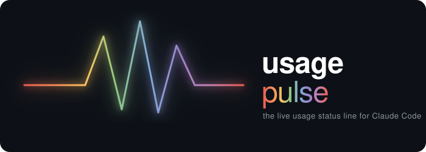
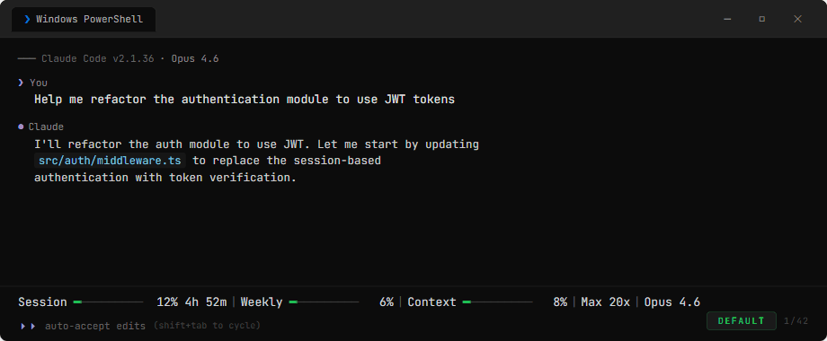
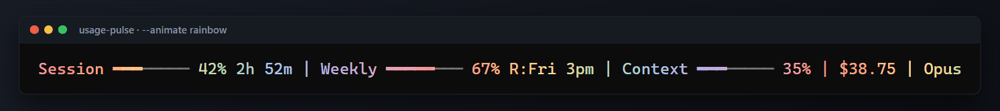
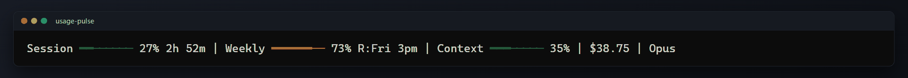
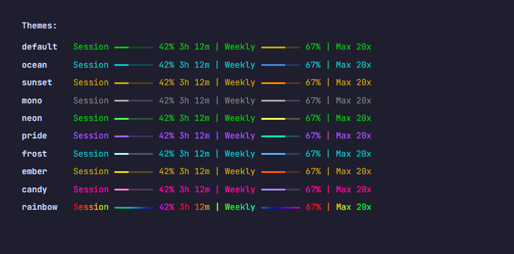
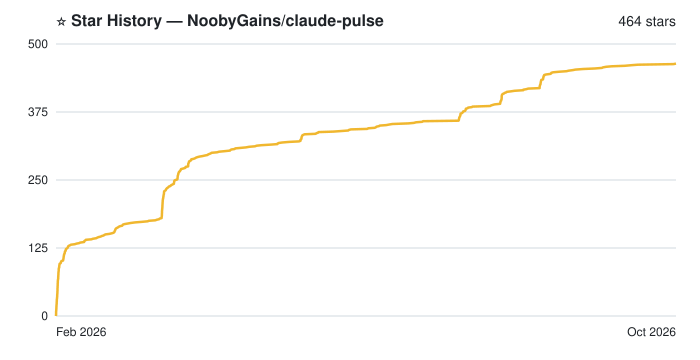

<p align="center">
  
</p>

<p align="center">
  Real-time usage monitor for Claude Code: session and weekly limits, your other subscriptions, cost, agent teams and 10 themes with animations. All in your status bar.
</p>

<p align="center">
  <a href="https://github.com/NoobyGains/claude-pulse/stargazers"></a>
  
  
  
  
  
  <a href="https://github.com/NoobyGains/claude-pulse/blob/main/LICENSE"></a>
  <a href="https://buymeacoffee.com/noobygains"></a>
</p>

---

## What is this?

A single-file Python status bar for Claude Code. It shows how much of your 5-hour and weekly limits you have used, what the session costs, how full the context window is, and what your agents are doing. If you have more than one subscription (a second Claude account, Codex, Gemini), each one gets its own row underneath.

It needs no API key and no dependencies, and it works with your existing Claude Code login. Setup is a guided wizard with live previews.

<p align="center">
  
  <br>
  <sub>10 built-in themes with colour-coded bars that shift green, yellow, red as usage increases</sub>
</p>

<p align="center">
  
  <br>
  <sub>Rainbow animation: a flowing gradient that shifts on every refresh</sub>
</p>

<p align="center">
  
  <br>
  <sub>Automatic update notifications for both claude-pulse and Claude Code</sub>
</p>

## What you see

The default bar, as Claude Code draws it under your prompt:

```
Session ━━━───────── 27% 2h 53m | Weekly ━━━━━━━━━─── 73% R:Fri 3pm | Context ━━━━──────── 35% | $38.75 | +142 -37 | Opus 5.5 | Effort: XHigh | ⚡fast | main
```

1. **Session**: the 5-hour window, with the time until it resets.
2. **Weekly**: the 7-day window, with the day and time it resets (`R:` is a prefix you can change).
3. **Context**: how full the context window is. A `⚠ Context` label appears above 90%, or above 70% while it fills quickly.
4. **Cost**: what this session would cost at API prices, in your own currency.
5. **Lines changed**: lines added and removed this session.
6. **Model**: the model Claude Code is using.
7. **Effort**: the reasoning effort level, colour-escalating as it rises.
8. **Fast mode**: shown only while Opus fast mode is on.
9. **Branch**: the current git branch.

With other subscriptions switched on, each one adds a row under the main line:

```
Claude (Defend) 5h ━━━───────── 27% 2h 53m | Weekly ━━━━━━━━━─── 73% R:Fri 3pm | Context ━━━━──────── 35% | $38.75 | +142 -37 | Opus 5.5 | Effort: XHigh | team 3 · tasks 4/7 | main
Claude (Sunny)  5h ──────────── 3%  R:3pm  | Weekly ━━━━━━━━──── 63% R:Wed 3pm
Gemini          5h ──────────── 1%  R:2am  | Weekly ━━━━━━━━──── 66% R:Fri 11pm
Codex           5h ━─────────── 12% R:3pm  | Weekly ──────────── 2%  R:Sun 2am
```

1. **Main line**: this window's own account. Its `Session` label becomes `Claude (<label>) 5h` so the rows line up.
2. **Another Claude account**: a second `CLAUDE_CONFIG_DIR`, read with that account's own login.
3. **Gemini**: Google Antigravity, read from its local status file.
4. **Codex**: read from Codex CLI's local session files.

See [Providers and accounts](#providers-and-accounts).

## Quick start

### Plugin marketplace

```
/plugin marketplace add NoobyGains/claude-pulse
/plugin install claude-pulse
/claude-pulse:setup
```

`/claude-pulse:setup` installs the status line with safe defaults. A plugin cannot register a status line by itself, so this step is needed. Then run `/claude-pulse:pulse setup` to choose hooks, providers, theme and widgets. Restart Claude Code.

### One-liner install

**macOS / Linux:**
```bash
curl -fsSL https://raw.githubusercontent.com/NoobyGains/claude-pulse/main/install.sh | bash
```

**Windows (PowerShell):**
```powershell
irm https://raw.githubusercontent.com/NoobyGains/claude-pulse/main/install.ps1 | iex
```

Both installers clone the repo to `~/.claude-pulse` and then run `--setup`. In a terminal that is the [setup wizard](#setup-wizard). Without a terminal (CI, a dotfiles script, or `CLAUDE_PULSE_NONINTERACTIVE=1`) it takes the defaults. `CLAUDE_PULSE_DIR` changes the install folder and `CLAUDE_PULSE_REPO_URL` changes where it clones from.

### Manual install

```bash
git clone https://github.com/NoobyGains/claude-pulse.git ~/.claude-pulse
python3 ~/.claude-pulse/claude_status.py --setup
```

Restart Claude Code. After that, `/pulse setup` inside Claude Code does the same job by asking you questions. `--install` is the older, prompt-free way: it installs the status line, the agent-panel rows and `/pulse`, and nothing else.

## Setup wizard

`python3 claude_status.py --setup` opens a full-screen guided setup. Every choice that changes how the bar looks has a live preview. It has 14 screens:

1. **Welcome**: a short report on what it found (Python, Claude Code, your config folder, `settings.json`, the current status line, hooks and `/pulse`).
2. **Status line**: install claude-pulse, or replace another tool's status line. The old command is printed at the end so you can put it back.
3. **Hooks**: live agents, agent team, heartbeat. See [Hooks](#hooks).
4. **Providers**: the other subscriptions it found on this machine. Tick the ones you want and rename them.
5. **Model caps**: the Opus, Sonnet and Fable weekly bars. Off by default because they cost one usage-API call per refresh.
6. **Theme**: the theme picker.
7. **Bar size**
8. **Bar style**
9. **Layout**
10. **Currency**: the one it detected comes first.
11. **Clock**: 12-hour or 24-hour reset times.
12. **Effort**: how the reasoning effort is written.
13. **Widgets**: the optional ones, such as cache hit rate, PR badge, 7-day cost and budget.
14. **Summary**: everything that will change.

Nothing is written until you confirm the summary. Esc on any screen leaves your machine exactly as it was, and the left arrow goes back one screen.

The unattended version, `--setup --non-interactive`, is what runs when there is no terminal. It installs the status line, the agent-panel rows and `/pulse`, and switches on any Claude accounts, Codex and Gemini it detects. It never enables MiniMax and it installs no hooks.

Git Bash's mintty window cannot run the full-screen screens. Use Windows Terminal or PowerShell, or prefix the command with `winpty`.

Before any write, the current `settings.json` is copied to `settings-backups/` in the [state folder](#where-things-live), keeping the newest five per config folder.

## Providers and accounts

Providers add one status row per *other* subscription. `--detect-providers` shows what this machine has, and the wizard (or `/pulse providers`) turns rows on.

| What | Id | Where it is read from |
|---|---|---|
| Other Claude Code accounts | `claude:default`, `claude:<suffix>` (for example `claude:b` for `~/.claude-b`) | Every `~/.claude*` folder that holds a `.credentials.json` |
| Codex CLI | `codex` | Session files under `~/.codex` |
| Google Antigravity (Gemini) | `gemini`, `gemini:<suffix>` | `statusline_last_live.json` under `~/.gemini/antigravity-cli*` |
| MiniMax | `minimax` | The `mmx` CLI on your PATH. Never switched on automatically |
| Anything else | `file:<name>` | A JSON file that any tool can write |

```bash
python3 ~/.claude-pulse/claude_status.py --detect-providers          # what is here
python3 ~/.claude-pulse/claude_status.py --providers enable claude:b,codex
python3 ~/.claude-pulse/claude_status.py --providers label claude:b Work
python3 ~/.claude-pulse/claude_status.py --providers list
```

The sub-commands are `list`, `detect`, `enable`, `disable`, `label`, `remove` and `add-file`. Add `--json` to `--detect-providers` for machine-readable output. Labels are 24 characters at most, and up to 8 providers can be configured.

### How the rows behave

- Rows use the same theme, bar style and bar size as the main line. At most 6 are shown.
- **Other Claude accounts** use that account's own token, read from its `.credentials.json`. The token is never refreshed, stored or logged. The status line makes at most one usage-API call per account every `providers_refresh_seconds` (300 by default, 60 at the lowest), and never more than one per minute. A 429 backs off, and a 401 or 403 waits 15 minutes.
- Each Claude Code window also saves its own account's numbers from the data Claude Code pipes in. With both windows open, no API call is needed at all.
- **Codex and Gemini** rows are read from local files only. They show the last values seen, not live ones.
- **MiniMax** runs `mmx` to read its quota, which is why it is never on by default. It is hidden while the window itself runs on MiniMax.
- A Claude or MiniMax row whose data is more than 30 minutes old is drawn with dim bars and a `~` in front of the percentage, for example `~29%`.
- In the compact and minimal layouts the rows line up with each other but not with the main line.

### Your own provider: a JSON file

`--providers add-file <id> <path> [label]` adds a row that is read from a JSON file. Anything that can write a file can feed it, for example a small script that polls another service. The id is stored as `file:<id>`.

```json
{"label": "Kimi",
 "five_hour": {"used_percentage": 42, "resets_at": 1792386351},
 "seven_day": {"used_percentage": 7,  "resets_at": "2026-10-26T10:00:00Z"}}
```

- The two windows can sit at the top level or inside a `rate_limits` object, which is the shape Claude Code itself uses.
- `utilization` is accepted in place of `used_percentage`.
- `resets_at` can be epoch seconds, epoch milliseconds or an ISO 8601 time. It is optional, and a reset time in the past reads as 0%.
- Either window may be missing. The file may be 1 MB at most.

### Multiple Claude accounts

The pattern Claude Code supports is one config folder per account:

```bash
CLAUDE_CONFIG_DIR=~/.claude-work claude
```

Run `--setup` once per account with that variable set, so each account's `settings.json` gets the status line:

```bash
CLAUDE_CONFIG_DIR=~/.claude-work python3 ~/.claude-pulse/claude_status.py --setup
```

State that belongs to one account (usage cache, stdin context, history, sessions, heatmap and cost caches) lives in `<state folder>/accounts/<name>-<hash>/`, so two windows on two accounts no longer overwrite each other. The default `~/.claude` account keeps the shared folder, so nothing moves if you only have one. `config.json` stays shared between accounts.

## Widgets

Switch any widget on or off with `--show <id>` and `--hide <id>`, or with the wizard. Several ids can be given at once, comma-separated. The "Default" column is what you get before you change anything.

| Id | Default | What it shows |
|---|---|---|
| `session` | on | The 5-hour window as a bar, with percentage |
| `timer` | on | Time until the session window resets |
| `weekly` | on | The 7-day window as a bar |
| `weekly_timer` | on | When the weekly window resets (`--weekly-timer-format`, `--weekly-timer-prefix`) |
| `context` | on | Context window usage, as a percentage or in tokens (`--context-format`) |
| `context_warning` | on | The `⚠ Context` label and a fast-rising arrow as the window fills |
| `cost` | on | Session cost at API prices, in your currency |
| `model` | on | The active model |
| `branch` | on | The current git branch |
| `effort` | on | Reasoning effort, such as `Effort: XHigh` (`--effort-format`) |
| `fast_mode` | on | `⚡fast` while Opus fast mode is on |
| `agent` | on | `▸name` of the active subagent |
| `worktree` | on | The worktree branch, when you work in one |
| `lines` | on | `+142 -37`, lines added and removed this session |
| `subagents` | on | `agents 3 live · 47/200`, needs the [agents hook](#hooks) |
| `team` | on | `team 3 · tasks 4/7`, needs the [team hooks](#agent-teams) |
| `budget` | on | A spend bar against the amount from `--budget`. Appears once a budget is set |
| `spend_limit` | on | `spend $12.40/$50 wk`, only when a Claude apps gateway reports a spend limit |
| `providers` | on | The extra rows for [other subscriptions](#providers-and-accounts) |
| `pomodoro` | on | The focus timer, while one is running (`--focus start 25`) |
| `staleness` | on | `(5m ago)` when the data on screen is old |
| `update` | on | `↑ Pulse Update` when a new claude-pulse release exists |
| `claude_update` | on | `↑ Claude Update` when a new Claude Code release exists |
| `opus`, `sonnet`, `fable` | off | Per-model weekly cap bars. These call the usage API, see [below](#per-model-weekly-caps) |
| `plan` | off | Your plan name |
| `extra` | off | Extra-usage (bonus) credits. Appears by itself if you have any (`--extra-display`) |
| `thinking` | off | `think` or `no-think` |
| `cache` | off | Share of input served from the prompt cache |
| `cache_warm` | off | Prompt-cache warmth, such as `♨ 92% · 3m` |
| `pr` | off | Clickable `#123` pull request badge with review state. GitLab merge requests show as `!123` |
| `repo` | off | `owner/name` of the current repository |
| `session_name` | off | The name you gave the session with `/rename` |
| `weekly_cost` | off | Rolling 7-day API-equivalent cost |
| `cumulative_cost` | off | API-equivalent cost across all sessions |
| `burn_rate` | off | How fast the window is filling, such as `↑3%/hr` |
| `runway` | off | Estimated time until the window is full |
| `sparkline` | off | A small chart of recent session usage |
| `status_message` | off | Replaces the `Session` label with a short message such as `Cruising` |
| `pace` | off | How much of the window's time has passed, next to the bar |
| `streak` | off | Days in a row you have used Claude Code (`--streak-style`) |
| `sessions` | off | `+2 sessions` when other windows are open |
| `git_drift` | off | Commits behind and ahead of upstream |
| `files_changed` | off | Count of uncommitted files |
| `heartbeat` | off | Spinner, tool count and elapsed time. Needs the [heartbeat hook](#hooks) |
| `activity` | off | `⚡ Active` during a burst of tool calls. Needs the heartbeat hook |
| `last_tool` | off | The last tool Claude used. Needs the heartbeat hook |

`cache_warm`, `spend_limit`, `repo` and `session_name` are new in 3.4.0. They read fields that Claude Code already pipes in, so they cost nothing: no network and no hook. When a subagent has no name, the agent panel falls back to its type.

Order is controlled by priority numbers. `--priority` lists them, and `--priority model=5,cost=15` moves the model first and the cost after the session. Lower is further left.

### Per-model weekly caps

The `opus`, `sonnet` and `fable` bars show your weekly cap for each model, when your plan reports one. Claude Code's own input carries only the 5-hour and 7-day windows, so these three come from the usage API, using your Claude Code login. They are therefore opt-in: `--show fable`, or the wizard's model caps screen. Each refresh is one API call, made at most every `model_caps_refresh_seconds` (300 by default, 60 at the lowest), and a failed attempt is not retried for 60 seconds. Claude Pro reports no model-scoped windows, so no bar appears there. This feature came from @thedanielmay in PR #53.

### Models and cost

The cost widgets price each turn with the rate that applies to its model:

| Model | Per million tokens (in / out) |
|---|---|
| Fable 5.1 | $10 / $50 |
| Opus 5.5 | $4 / $20 |
| Sonnet 5.5 | $2 / $10 |
| Haiku 5.5 | $0.10 / $0.50 up to 100K prompt tokens, $0.50 / $2.50 above |

All four have a 1M-token context window. Costs are API-equivalent: a figure to compare sessions by, not your bill. Set the currency with `--currency £`; it converts from USD using a daily exchange rate.

## Themes, animation and layout

<p align="center">
  
</p>

**10 themes**: default, ocean, sunset, mono, neon, pride, frost, ember, candy, rainbow. Set one with `--theme <name>` or `/pulse <name>`, or try them with `--pick-theme`, an arrow-key picker with a live preview.

**5 animation modes**, set with `--animate <mode>`:

| Mode | Effect |
|---|---|
| `off` | Static, no animation |
| `rainbow` | Flowing rainbow gradient across the entire bar |
| `pulse` | Bars cycle through vivid colours (cyan, blue, purple, pink, gold, green) |
| `glow` | Per-character gradient that shifts across the bar each frame |
| `shift` | Bright highlight slides across the bar |

`--animation-speed` takes `slow`, `normal` or `fast`. Animation advances on every repaint, which includes the 2-second `refreshInterval` that setup configures while animation is on, so the bar keeps moving while the session is idle.

**8 bar styles**, set with `--bar-style <name>`: classic, block, shade, pipe, dot, square, star, braille. If Unicode looks broken in your terminal, try `block`.

**Bar sizes**: small, small-medium, medium, medium-large, large (`--bar-size`).

**Layouts** (`--layout`): `standard` has full labels, `compact` uses one-letter labels, `minimal` drops the labels, and `percent-first` puts the number before the bar. `--max-width` sets the share of the terminal the bar may use, and `--wrap auto` wraps onto a second row instead of cutting the line off.

For a deliberate two-row split, set `line2_widgets` (these go to row 2) or `line1_widgets` (an allowlist for row 1, the rest flows to row 2) in `config.json`. `line1_widgets` wins if both are set.

## Hooks

Hooks are commands Claude Code runs when something happens. claude-pulse has three groups. Install the ones you want:

```bash
python3 ~/.claude-pulse/claude_status.py --install-hooks                       # all three
python3 ~/.claude-pulse/claude_status.py --install-hooks --only agents,team    # just these
```

The wizard's hooks screen does the same, and unticking a group there removes it again. Restart Claude Code after changing hooks.

| Group | Claude Code events | What it drives | What it costs |
|---|---|---|---|
| `agents` | SubagentStart, SubagentStop | The live agent counter, `agents 3 live · 47/200` | A short Python run when a subagent starts or stops |
| `team` | TeammateIdle, TaskCreated, TaskCompleted | The agent-team segment, `team 3 · tasks 4/7` | A short Python run on each of those events |
| `heartbeat` | PostToolUse | The spinner and tool count, plus `activity` and `last_tool` | A Python run after **every** tool call, and it keeps the repaint timer alive. This is why it is off by default |

The heartbeat widget itself is switched on with `--show heartbeat`.

**Hooks never block Claude.** For the events where exit code 2 would steer Claude Code (SubagentStop, TeammateIdle, TaskCreated, TaskCompleted), the installed command ends in `; exit 0`. Python exits 2 by itself when the script has been moved or deleted, and without the pin that would keep subagents running, delete new tasks or refuse completions.

`--install-hooks` refuses to touch a `settings.json` that is not valid JSON: it prints the problem and exits 1. Your other hooks are left alone.

## Agent teams

The `team` widget shows the teammates seen so far and the shared-task progress, for example `team 3 · tasks 4/7`. The task tally turns green when the list is done. It needs the `team` hook group, and agent teams need `CLAUDE_CODE_EXPERIMENTAL_AGENT_TEAMS=1`. Task counts need Claude Code's Task tools, which newer models only get with `CLAUDE_CODE_ENABLE_TODO_TOOLS=1`.

Subagents also get their own rows in the agent panel through `subagentStatusLine`: status, model, effort, a context bar and elapsed time. `--install` and `--setup` add that setting.

### Agent team limitations

The team segment only knows what the three team hooks tell it, so:

- **No "working" count.** Claiming or doing work fires no hook, so the segment shows how many teammates have appeared, not how many are busy.
- **Blocked by another hook.** claude-pulse records the event before any quality-gate hook of yours decides. A creation your hook blocks still counts as an open task, and a completion it blocks still counts as done.
- **Deleted tasks stay open.** Deleting a task with `TaskUpdate` fires no hook.
- **Reused task ids.** If a task's completion is recorded before its creation, a later task with the same id stays hidden.
- **Split-pane teammates** (tmux/iTerm2) run as separate sessions with their own session id, so they don't appear in the lead's segment. In-process teammates, the default, do.
- **Six-hour sweep.** Once nothing in a session has changed for six hours its team state is removed, open tasks included.

## Configuration

The easy way is `/pulse` in Claude Code, or `--setup`. The flags below do the same from a shell, and the whole list is in [Full flag list](#full-flag-list).

```bash
--theme ocean              # default, ocean, sunset, mono, neon, pride, frost, ember, candy, rainbow
--animate rainbow          # off, rainbow, pulse, glow, shift
--bar-size large           # small, small-medium, medium, medium-large, large
--bar-style block          # classic, block, shade, pipe, dot, square, star, braille
--layout compact           # standard, compact, minimal, percent-first
--currency £               # $, £, €, ¥, C$, A$, ₹, kr, and 20+ more
--clock-format 12h         # 12h or 24h
--effort-format labeled    # labeled 'Effort: Medium', full 'Medium', short 'med'
--budget 25                # spend bar; use the number you pass to Claude Code's --max-budget-usd
--limits subagent_spawns=200,subagent_concurrent=20,web_searches=200
--show cache,pr            # turn widgets on
--hide cost                # turn a widget off
--preset minimal           # a compact bundle; --preset default is a factory reset
--focus start 25           # focus timer; --focus stop, --focus status
--config                   # print the current configuration
--stats                    # usage statistics and streaks
--heatmap                  # activity heatmap
--update                   # update a git install
```

`--budget` exists because Claude Code's `--max-budget-usd` can only be given on its command line and cannot be read from the status line. Set the same number here to track spend against it. `--limits` sets the denominators for the subagent counter, since Claude Code enforces those caps but does not report them.

### Where things live

| What | Windows | macOS / Linux |
|---|---|---|
| `config.json` | `%LOCALAPPDATA%\claude-status\` | `~/.config/claude-status/` (or `$XDG_CONFIG_HOME`) |
| State and caches | `%LOCALAPPDATA%\claude-status\` | `~/.cache/claude-status/` (or `$XDG_CACHE_HOME`) |
| Settings backups | `<state folder>/settings-backups/` | `<state folder>/settings-backups/` |
| Claude Code's `settings.json` | `$CLAUDE_CONFIG_DIR` or `~/.claude` | `$CLAUDE_CONFIG_DIR` or `~/.claude` |

### `config.json` keys

| Key | Meaning |
|---|---|
| `theme`, `animate`, `animation_speed`, `text_color` | Colours and animation |
| `bar_size`, `bar_style`, `layout`, `max_width`, `wrap` | Shape of the bars and line |
| `show` | Widget on/off map (see [Widgets](#widgets)) |
| `widget_priority` | Widget order, for example `{"model": 5}` |
| `line1_widgets`, `line2_widgets` | Two-row split |
| `currency`, `budget_usd`, `limits` | Cost display |
| `clock_format`, `effort_format`, `context_format`, `extra_display`, `streak_style` | Number and time formats |
| `weekly_timer_format`, `weekly_timer_prefix` | The weekly reset timer |
| `providers` | List of `{id, type, enabled, label?, dir or path, bucket?}`. Manage it with `--providers` |
| `providers_label_main` | `true` by default. Names the main line `Claude (<label>) 5h` on the standard layout |
| `providers_refresh_seconds` | Poll interval for other Claude accounts. Default 300, minimum 60 |
| `model_caps_refresh_seconds` | Poll interval for the per-model caps. Default 300, minimum 60 |

### The refresh timer

Claude Code repaints the status line on its own events (a prompt, a tool call). Anything that moves with the clock, such as animation frames, the focus countdown or the heartbeat's elapsed time, needs a timer as well. Setup writes `statusLine.refreshInterval` into `settings.json` for this: 2 seconds while animating, 15 seconds for time-based widgets, and nothing at all for a static bar. It is kept in sync whenever you change a setting.

## Full flag list

This is the output of `python claude_status.py --help`:

```
claude-pulse 3.4.1 — usage status line for Claude Code

Usage: python claude_status.py [flag [args]]
With no flag and JSON on stdin (how Claude Code runs it) it prints the status line.

Setup
  --setup [--non-interactive]         Guided setup: status line, hooks, providers, theme, widgets
  --install                           Install the status line, agent-panel rows and /pulse (no questions)
  --update                            Update a git install to the latest release
  --help                              Show this list (also -h)

Look
  --theme <name>                      Set the colour theme (see --themes)
  --pick-theme                        Arrow-key theme picker with a live preview
  --pick                              Same as --pick-theme
  --themes                            List themes
  --themes-demo                       Preview the status line in every theme
  --show-themes                       Theme previews in their accent colours
  --show-colors                       List text colours
  --show-all                          --show-themes and --show-colors together
  --text-color <name|auto>            Colour for labels and percentages
  --animate <off|rainbow|pulse|glow|shift>
                                      Bar animation
  --animation-speed <slow|normal|fast>
                                      Animation speed
  --bar-size <small|small-medium|medium|medium-large|large>
                                      Bar width
  --bar-style <name>                  Bar characters (classic, block, dot, braille, ...)
  --layout <standard|compact|minimal|percent-first>
                                      How labels, bars and numbers are arranged
  --max-width <20-100>                Percent of the terminal width to use
  --wrap <off|auto>                   Wrap onto a second row instead of truncating
  --preset <minimal|default>          Apply a bundle of settings (default = factory reset)

Widgets
  --show <parts>                      Turn widgets on (comma-separated)
  --hide <parts>                      Turn widgets off (comma-separated)
  --priority <widget=N,...>           Reorder widgets (lower = further left)
  --currency <symbol>                 Currency for cost widgets (converted from USD)
  --clock-format <12h|24h>            Clock for reset times
  --effort-format <labeled|full|short>
                                      How reasoning effort is written
  --context-format <percent|tokens>   Context window as a percentage or tokens
  --extra-display <auto|full|amount>  How extra-usage credits are shown
  --weekly-timer-format <auto|countdown|date|full>
                                      Weekly reset timer style
  --weekly-timer-prefix <text>        Text before the weekly reset time (e.g. R:)
  --streak-style <fire|text>          Usage streak style
  --budget <amount|off>               Spend budget to match --max-budget-usd
  --limits [key=N,...]                Subagent and web-search caps used as denominators
  --focus <start [min]|stop|status>   Focus (pomodoro) timer

Providers
  --detect-providers [--json]         Find other Claude accounts, Codex, Gemini and MiniMax on this machine
  --providers <list|detect|enable|disable|label|remove|add-file> [...]
                                      Manage the extra status rows: --providers help lists the sub-commands

Hooks
  --install-hooks [--only heartbeat,agents,team]
                                      Install hooks (all three groups unless --only)

Info
  --config                            Print the current configuration
  --stats                             Usage statistics and streaks
  --heatmap                           Usage heatmap
  --debug-stdin                       Save and parse the JSON Claude Code pipes in

Internal
  --subagent-status-line              Agent-panel rows (run by Claude Code)
  --hook-refresh [tool]               PostToolUse hook
  --hook-subagent-start               SubagentStart hook
  --hook-subagent-stop                SubagentStop hook
  --hook-teammate-idle                TeammateIdle hook
  --hook-task-created                 TaskCreated hook
  --hook-task-completed               TaskCompleted hook

Inside Claude Code: /pulse (or /pulse setup) does all of this by asking you.
```

Inside Claude Code, `/pulse` opens a menu: Setup, Look, Widgets, Providers, Hooks and Info. You can also go straight to a part: `/pulse setup`, `/pulse providers`, `/pulse hooks`, `/pulse ocean` (any theme name), `/pulse show`.

## How it works

```
┌───────────────────────────────────────────────┐
│  Claude Code                                  │
│  Pipes JSON via stdin on every status refresh │
│  (model, context, cost, rate_limits, effort,  │
│   fast_mode, agent, pr, prompt_cache, repo)   │
├───────────────────────────────────────────────┤
│  claude_status.py                             │
│  Reads stdin → builds the ANSI status line    │
│  No API calls for the main bars (v2.1.80+)    │
├───────────────────────────────────────────────┤
│  Hooks (optional)                             │
│  Agents, team, heartbeat: write small state   │
│  files that the next repaint reads            │
├───────────────────────────────────────────────┤
│  Provider rows (optional)                     │
│  Local files for Codex, Gemini, JSON files;   │
│  one cached usage call per other Claude acct  │
├───────────────────────────────────────────────┤
│  Cache layer                                  │
│  Exchange rates (24h) · update checks (1h)    │
│  cumulative + weekly cost (5m) · 429 backoff  │
│  animation state · history                    │
└───────────────────────────────────────────────┘
```

**Rate limits from stdin.** Claude Code sends `rate_limits` on stdin, the 5-hour and 7-day windows, so the main bars need no OAuth call and cannot be rate limited. The API is used for three things, all optional or rare: extra (bonus) credits, the per-model caps you opted into, and the rows for other Claude accounts when none of their windows is open. A 429 backs off exponentially instead of retrying on every repaint.

**Several windows.** Each window keeps its own account's state apart (see [Multiple Claude accounts](#multiple-claude-accounts)).

**Corrupt state cannot blank the bar.** A truncated or hand-edited cache or settings file degrades to a cache miss instead of raising on the hot path.

## Security

- **No API calls for the main usage bars.** They come straight from Claude Code's stdin.
- **Tokens only go to Anthropic.** OAuth tokens are sent only to `api.anthropic.com` (usage) and `platform.claude.com` (renewing your own expired token, kept in memory and never written back). A hardcoded allowlist enforces this, and redirects to any other host are blocked.
- **Other accounts' tokens are read, never changed.** For a provider row, the token is read from that account's `.credentials.json` and is never refreshed, stored or logged. Refreshing it would rotate the refresh token and sign that account out.
- **No e-mail addresses or account names are read.** Labels come from your config or from the folder name.
- **Settings are backed up.** Before claude-pulse first writes `settings.json` it keeps a copy, and `--install-hooks` refuses to replace a file that is not valid JSON.
- All file writes use atomic operations with 0o600 permissions
- ANSI escape injection prevention on all external data, including provider labels and file contents
- Hyperlink targets (PR badge) restricted to `http(s)` and rejected if they contain control characters, so nothing can break out of the OSC 8 escape
- No `shell=True` in any subprocess call
- Exchange rate API (frankfurter.dev): no auth, read-only, cached 24h

## Requirements

- **Python 3.8+** (no pip installs needed)
- **Claude Code** v2.1.80+ with a Pro or Max subscription (Fable reporting needs v2.1.170+)
- No API key required: it uses Claude Code's existing credentials

## Troubleshooting

| Issue | Fix |
|---|---|
| No status line visible | Run `--setup` (or `/claude-pulse:setup` for the plugin) and restart Claude Code |
| `--setup` says it used the defaults | It found no interactive terminal. Run it in Windows Terminal, PowerShell or a normal shell, not Git Bash's mintty |
| Setup says `settings.json` is invalid | Fix the JSON it names and run setup again. Nothing was changed |
| Replaced my old status line by mistake | Setup prints the old command. Earlier copies of `settings.json` are in `settings-backups/` in the state folder |
| A provider row is missing | `--providers list` shows what is configured and `--detect-providers` what exists. Check that the `providers` widget is on |
| A Claude or MiniMax row shows `~29%` with dim bars | The data is more than 30 minutes old. Use that account once, or wait for the next refresh |
| A provider row shows `--` | The source could not be read yet: no token, a missing file, or no rate-limit data in the newest Codex session |
| "Rate limited" message | The main bars read stdin, so they keep working. API-backed parts back off exponentially before retrying |
| Animation or timer frozen when idle | Run `--setup` or `--install` again. The real setting is `statusLine.refreshInterval` |
| Opus/Sonnet/Fable bar missing | They are off by default (`--show fable`). They also render only when your plan reports that cap, and Claude Pro returns none |
| Heartbeat not showing | Run `--install-hooks --only heartbeat`, switch the widget on with `--show heartbeat`, and restart Claude Code. It shows after the first tool call |
| Heartbeat appears/disappears | Normal. It shows when hook state is fresh (within 5 min of the last tool call) |
| Settings error after hook install | Run `/doctor`. Hooks need the nested format `{matcher, hooks: [{type, command}]}` |
| Stale data showing | Data refreshes on every interaction. If idle, it shows the last known state |
| Unicode characters broken | Try `--bar-style block` for better Windows terminal support |

## Changelog

What changed in each release is in [CHANGELOG.md](CHANGELOG.md).

## Support

If this project helped you, consider starring the repo, sharing it with others, or buying me a coffee.

<a href="https://buymeacoffee.com/noobygains"></a>

## Star History

<!-- Rendered weekly by .github/workflows/star-history.yml — GitHub restricted
     the stargazers API (June 2026), so third-party live charts no longer work
     for public visitors; the repo renders and commits its own. -->
<a href="https://github.com/NoobyGains/claude-pulse/stargazers">
   <picture>
     <source media="(prefers-color-scheme: dark)" srcset="assets/star-history-dark.svg" />
     <source media="(prefers-color-scheme: light)" srcset="assets/star-history.svg" />
     
   </picture>
</a>

## License

MIT, see [LICENSE](LICENSE) for details.

---

<p align="center">
  Made by <a href="https://github.com/NoobyGains">NoobyGains</a> · <a href="https://www.reddit.com/user/PigeonDroid/">PigeonDroid</a>
</p>
